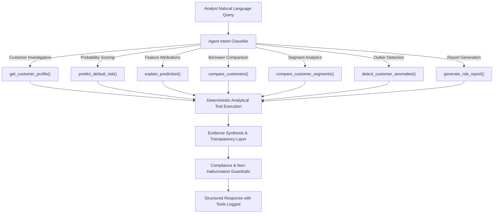

# CreditLens AI — Agent Workflow & Guardrails

---

## 🛡️ Core Banking Safety Boundaries

1. **Zero Hallucination Policy**: All metrics, credit lines, delinquency counts, and probabilities are retrieved strictly from deterministic Python tools.
2. **Read-Only / Decision Support**: The agent cannot approve or deny loan applications. It is strictly an investigatory assistant for risk officers.
3. **No Parameter Alteration**: The agent has zero write access to risk cutoff thresholds or model weights.
4. **Tool Execution Transparency**: Every response explicitly displays which deterministic backend functions were executed (`tools_executed`).
