# CreditLens AI — System Architecture

```mermaid
flowchart TD
    subgraph Client["Frontend Client (React 19 + TypeScript + Vite)"]
        UI_Overview["Overview Dashboard"]
        UI_Directory["Customer Directory"]
        UI_Assessment["Risk Assessment & SHAP"]
        UI_Analytics["Portfolio Analytics"]
        UI_Agent["AI Risk Investigator"]
        UI_Monitoring["Model Drift & Anomaly Telemetry"]
        UI_Reports["Audit Report Exporter"]
    end

    subgraph Gateway["FastAPI Server (Python 3.12)"]
        API_Health["/api/health"]
        API_Customers["/api/customers"]
        API_Predict["/api/predictions/predict"]
        API_Model["/api/model/*"]
        API_Analytics["/api/analytics/*"]
        API_Agent["/api/investigator/chat"]
        API_Monitoring["/api/monitoring/*"]
        API_Reports["/api/reports/*"]
    end

    subgraph Intelligence["Credit Risk ML & Intelligence Engine"]
        Preproc["ColumnTransformer Preprocessing"]
        RF_Model["Random Forest Champion (100 Trees)"]
        Calibrator["Sigmoid Probability Calibration (CalibratedClassifierCV)"]
        SHAP["SHAP TreeExplainer Attributions"]
        IsoForest["Isolation Forest Anomaly Detector"]
        KSTest["Two-Sample Kolmogorov-Smirnov Drift Tester"]
    end

    subgraph AgentEngine["Autonomous Risk Agent"]
        Agent_Tools["Deterministic Python Analytical Tools"]
        Agent_Router["Intent State Machine & Synthesizer"]
    end

    subgraph Storage["Data & Model Storage"]
        SQLAlchemy["SQLAlchemy 2.0 ORM + Alembic"]
        DB[("PostgreSQL / SQLite")]
        Artifacts["Joblib Pipelines & JSON Metadata"]
        Reports["ReportLab PDF Exporter"]
    end

    Client --> Gateway
    Gateway --> Intelligence
    Gateway --> AgentEngine
    AgentEngine --> Intelligence
    Gateway --> Storage
    Intelligence --> Storage
```

---

## Data Flow Architecture

1. **Borrower Ingestion & Validation**: Raw UCI benchmark data is cleansed, verified for schema compliance, and stored.
2. **Stratified Preprocessing**: Prevents data leakage by fitting Scalers and One-Hot Encoders strictly on training splits.
3. **Calibrated Inference**: Random Forest estimates are calibrated using Sigmoid mapping, reducing Brier score error to 0.1368.
4. **Game-Theoretic Explainability**: Every prediction is matched with mathematical SHAP values explaining exact upward and downward risk drivers.
5. **Deterministic Agent Guardrails**: The AI Investigator can query, explain, and compare records via deterministic Python tools, but cannot approve loans or alter model weights.
